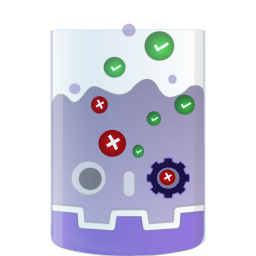

<p align="center">
  </br>
  <h1 align="center">gunit  </h1>
</p>
<h2 align="center">A Godot Embedded Unit Testing Framework</h2>

> **gunit** is a personal, GDScript-only fork of
> [GdUnit4](https://github.com/MikeSchulze/gdUnit4) by Mike Schulze, released under the MIT license.
> It is not affiliated with or endorsed by the upstream project.
> The public API keeps the upstream `GdUnit*` class names so existing test suites keep working.

<h1 align="center">Supported Godot Versions</h1>
<p align="center">
  
  
  
  
  
  
  
  
  
  
  
</p>

<h1 align="center">Compatibility Overview</h1>
<table align="center">
  <thead>
 <tr>
   <th>gunit Version</th>
   <th>Godot minimal required/compatible Version</th>
 </tr>
  </thead>
  <tbody>
    <tr>
      <td>master (v7.0.0)</td><td>v4.7, v4.7.1, v4.8.dev7</td>
    </tr>
    <tr>
      <td>v6.2.x</td><td>v4.5, v4.5.1, v4.5.2, v4.6, v4.6.1, v4.6.2, v4.6.3, v4.7, v4.7.1</td>
    </tr>
    <tr>
      <td>v6.1.x</td><td>v4.5, v4.5.1, v4.5.2, v4.6, v4.6.1, v4.6.2, v4.6.3</td>
    </tr>
    <tr>
      <td>v6.0.x+</td><td>v4.5, v4.5.1, v4.5.2</td>
    </tr>
    <tr>
      <td>v5.x+</td><td>v4.3, v4.4, v4.4.1</td>
    </tr>
    <tr>
      <td>v4.4.0+</td><td>v4.2.0, v4.3, v4.4.dev2</td>
    </tr>
    <tr>
      <td>v4.3.2+</td><td>v4.2.0, v4.3</td>
    </tr>
    <tr>
      <td>v4.3.0, v4.3.1</td><td>v4.2.0</td>
    </tr>
    <tr>
      <td>v4.2.1-v4.2.5</td><td>v4.1.0</td>
    </tr>
    <tr>
      <td>v4.2.0 and older</td><td>v4.0</td>
    </tr>
  </tbody>
</table>

<p align="center">
  </br>
</p>

## What is gunit?

**g**(*Godot*)**unit**(*Unit Testing*)

gunit is an embedded unit testing framework designed for testing GDScript files and scenes in the Godot editor.
With gunit, you can easily create and run unit tests to verify the functionality and performance of your code, ensuring
that it meets your requirements and specifications.<br>
gunit is a powerful tool that supports Test-Driven Development ([TDD](https://en.wikipedia.org/wiki/Test-driven_development)), a popular software development
approach that emphasizes creating automated tests before writing any code. By using gunit for TDD, you can
ensure that your code is thoroughly tested and free of bugs, which can save you time and effort in the long run.

---

## Features

### Core Testing Features

* **GDScript Test Support**  
  Write and execute tests in GDScript
* **Embedded Test Inspector**  
  Navigate your test suites directly within the Godot editor
* **Test Discovery**  
  Automatically searches for tests at runtime and adds them to the inspector
* **Convenient Interface**  
  Run test-suites directly from Godot using the context menu (FileSystem panel, ScriptEditor, or gunit Inspector)
* **Create Tests from Editor**  
  Right-click on any function in the ScriptEditor and select "Create TestCase" to generate tests automatically

### Test Writing & Assertions

* **Fluent Syntax**  
  Write test cases with an easy-to-read, fluent interface
* **Wide Range of Assertions**  
  Comprehensive assertion methods for verifying behavior and output
* **Argument Matchers**  
  Verify function calls with expected arguments
* **Unicode Text Support**  
  Full support for unicode characters in test strings and assertions
* **Variadic Arguments Support**  
  Test functions that accept variable numbers of arguments

### Advanced Testing Capabilities

* **Test Fuzzing**  
  Generate random inputs to test edge cases and boundary conditions
* **Parameterized Tests**  
  Test functions with multiple sets of inputs and expected outputs
* **Test Session Hooks**  
  Set up and tear down test resources at the session level for efficient test management
* **Mocking & Spying**
  * Mock classes to simulate behavior and define output for specific functions
  * Spy on functions to verify they were called with expected parameters
  * Mock or spy on scenes to simulate behavior and verify function calls
* **Scene Runner**  
  Simulate different kinds of inputs and actions:
  * Mouse clicks and movements
  * Keyboard inputs
  * Touch screen interactions
  * Custom input actions
  * Wait for specific signals or function return values
* **Flaky Test Handling**  
  Detect and handle flaky tests by rerunning failed tests  
  Configure retry count and mark non-deterministic failures in test results
* **Orphan Node Detection**  
  Detect orphan nodes, listed with stack traces and detailed info
* **Configurable Templates**  
  Customize templates for generating new test-suites

### Continuous Integration Support

* **Command Line Tool**  
  Run tests outside the Godot editor for CI/CD pipelines
* **HTML Report Generation**  
  Generate comprehensive HTML test reports
* **JUnit XML Report**  
  Export test results in JUnit XML format for CI integration
* **GitHub Action Integration**  
  Public marketplace action for integrating gunit into your CI workflow  
  [gdunit4-action](https://github.com/marketplace/actions/gdunit4-test-runner-action)

---

## Basic Test Example

 ```gdscript
class_name GdUnitExampleTest
extends GdUnitTestSuite

func test_example():
  assert_str("This is an example message")\
    .has_length(26)\
    .starts_with("This is an ex")
 ```

 ---

## Advanced Example: Automated Testing in Godot

[](https://www.youtube.com/watch?v=CreugthdgJ0)

This excellent example is provided by [Godotneers](https://www.youtube.com/@godotneers) and demonstrates how to effectively test your game scenes using gunit.
The video walks through practical automated testing techniques that can help improve your Godot project's reliability and maintainability.

## Documentation

The fork keeps the upstream GDScript API. These links point to the upstream GdUnit4 documentation:

<p align="left" style="font-family: Bedrock; font-size:21pt; color:#7253ed; font-style:bold">
  <a href="https://godot-gdunit-labs.github.io/gdUnit4/latest/first_steps/install/">How to Install the gunit plugin</a>
</p>

<p align="left" style="font-family: Bedrock; font-size:21pt; color:#7253ed; font-style:bold">
  <a href="https://godot-gdunit-labs.github.io/gdUnit4/latest/">API Documentation</a>
</p>

---

### You Are Welcome To

* [Report Bugs](https://github.com/uvw327/gunit/issues/new?template=bug_report.yml) on the gunit GitHub Issues page.
* [Suggest Improvements](https://github.com/uvw327/gunit/issues/new?template=feature_request.yml) on the gunit GitHub Issues page.

---

## gunit Test Coverage and Code Quality

### Test Coverage

gunit is comprehensively tested with its own test suite to ensure robust functionality.<br>
The release workflow validates the packaged addon when a `v*` tag is pushed.

### Code Formatting

🙏 Special Thanks to the @atelico team for creating [gdstyle](https://github.com/atelico/gdstyle), a valuable tool contributing to code quality.

---

### Contribution Guidelines

**Thank you for your interest in contributing to gunit!**<br>
To ensure a smooth and collaborative contribution process, please review our
[contribution guidelines](CONTRIBUTING.md) before getting started.
These guidelines outline the standards and expectations we uphold in this project.

**Code of Conduct:**<br>
We strictly adhere to the Godot code of conduct in this project.
As a contributor, it is important to respect and follow this code to maintain a positive and inclusive community.

**Using GitHub Issues:**<br>
We utilize GitHub issues on this repository for tracking feature requests and bug reports.

We value your input and appreciate your contributions to make gunit even better!

---

<p align="left">
  
  </br>
  
  
  
</p>

## Upstream

gunit is derived from [GdUnit4](https://github.com/MikeSchulze/gdUnit4). The upstream project and its
contributors are credited in [LICENSE](LICENSE) and the source history. This fork is maintained independently
and is not endorsed by the upstream project.
